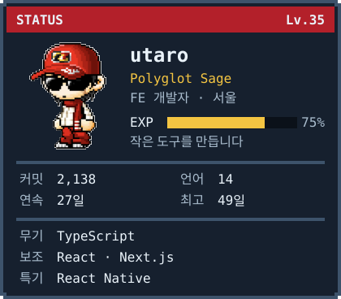

 

<!-- projects:start -->
<pre>$ ls ~/projects
chakuchaku/          TS    일본어 독서 단어장
<a href="https://github.com/chromeheartz/merry-gitmas">merry-gitmas/</a>        TS    커밋으로 자라는 픽셀 트리
<a href="https://github.com/chromeheartz/todoru.sh">todoru.sh/</a>           TS    슬래시 명령어로 쓰는 터미널 TODO
<a href="https://github.com/chromeheartz/claude-kun">claude-kun/</a>          Swift 메뉴바에서 보는 Claude Code 세션
<a href="https://github.com/chromeheartz/byeollo">byeollo/</a>             HTML  다녀온 가게로 잇는 나만의 별자리
<a href="https://github.com/chromeheartz/asciikun">asciikun/</a>            JS    아스키아트를 뿌려주는 CLI
<a href="https://github.com/chromeheartz/coding-rpg-box">coding-rpg-box/</a>      JS    GitHub 활동으로 만드는 RPG 스탯 카드</pre>
<!-- projects:end -->

[Portfolio](https://utaro-dev.com) · [Instagram](https://www.instagram.com/taeutaro/)
