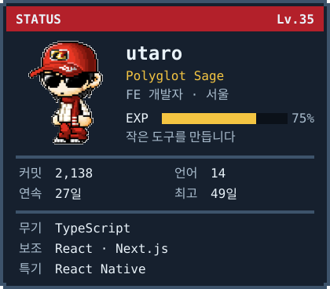

 

<!-- projects:start -->
<pre>$ ls ~/projects
<a href="https://apps.apple.com/kr/app/%EC%B0%A9%EC%B0%A9-%EB%8B%A8%EC%96%B4%EC%9E%A5/id6835701248">chakuchaku/</a>     TS    일본어 독서 단어장 · <a href="https://apps.apple.com/kr/app/%EC%B0%A9%EC%B0%A9-%EB%8B%A8%EC%96%B4%EC%9E%A5/id6835701248">App Store ↗</a>
<a href="https://github.com/chromeheartz/sodeung">sodeung/</a>        JS    웹 페이지의 불을 끄는 다크 모드 확장 · <a href="https://chromewebstore.google.com/detail/sodeung/ljhchpcogdklccgoekpjmmhpibaddfpd">Chrome ↗</a>
<a href="https://github.com/chromeheartz/claude-kun">claude-kun/</a>     Swift 메뉴바에서 보는 Claude Code 세션
<a href="https://github.com/chromeheartz/byeollo">byeollo/</a>        HTML  다녀온 가게로 잇는 나만의 별자리
<a href="https://github.com/chromeheartz/asciikun">asciikun/</a>       JS    아스키아트를 뿌려주는 CLI
<a href="https://github.com/chromeheartz/coding-rpg-box">coding-rpg-box/</a> JS    GitHub 활동으로 만드는 RPG 스탯 카드
<a href="https://github.com/chromeheartz/merry-gitmas">merry-gitmas/</a>   TS    커밋으로 자라는 픽셀 트리
<a href="https://github.com/chromeheartz/todoru.sh">todoru.sh/</a>      TS    슬래시 명령어로 쓰는 터미널 TODO</pre>
<!-- projects:end -->

<!-- projects:start -->
<pre>@tanstack/query
<a href="https://github.com/TanStack/query/pull/12692/changes/1c266922af79a2fa2ec7ca57da389dc29ba70d0e">docs(framework/angular/guides): add the 'polling' guide</a>
<a href="https://github.com/TanStack/query/pull/12619/changes/2b9fc62efe048009085dbff705bbb5b7a13fc71b">docs(framework/{preact,react,solid}/guides): fix the "wont" typo to "won't"</a>
  
</pre>
<!-- projects:end -->

[Portfolio](https://utaro-dev.com) · [Instagram](https://www.instagram.com/taeutaro/)
